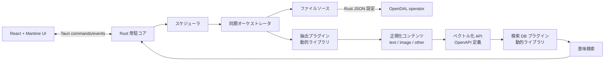

# Anydex

異なるファイルソースを横断して収集・解析し、テキスト、画像などの複数モダリティをベクトル化して意味検索できる、常駐型デスクトップアプリケーションです。

ファイルの置き場所、コンテンツ抽出器、ベクトル化 API、ベクタストアをそれぞれ差し替え可能にします。たとえば「S3 上の PDF とローカル画像を定期同期し、外部のマルチモーダル埋め込み API で処理して検索 DB に保存する」という構成を設定から組み立てられます。

> 実装状況: Tauri/Rust と React/Mantine の基盤、OpenDAL、ローカル SQLite vector の依存、設定モデルの一部が存在します。本書のプラグイン、同期パイプライン、OpenAPI 実行は目標アーキテクチャです。

## 全体像



## コンポーネントと責務

| コンポーネント | 責務 | 差し替え単位 |
| --- | --- | --- |
| Rust 常駐コア | 設定保存、ジョブ管理、再試行、状態・ログの集約、UI との通信 | アプリ本体 |
| ファイルソース | ファイル一覧、差分検出、内容の読み取り | OpenDAL のサービス設定 |
| 抽出器 | ファイルをモダリティ別の検索可能なチャンクへ変換 | 動的ライブラリプラグイン |
| ベクトル化 API | チャンクを各モダリティ用の embedding に変換 | OpenAPI 文書 + 操作設定 |
| 検索 DB | チャンク、メタデータ、ベクトルの永続化と類似検索 | 動的ライブラリプラグイン |
| UI | インデックス、接続、実行予定、ジョブ履歴、検索結果の管理画面 | React + Mantine |

## データの流れ

1. スケジューラ、または UI の手動実行が同期ジョブを開始する。
2. Rust コアがインデックスに紐づく `file_source` の JSON 設定から OpenDAL operator を生成する。
3. OpenDAL でファイルを列挙し、前回の同期状態（パス、更新時刻、ETag / version、ハッシュ）と比較する。
4. 新規・変更されたファイルだけを対応する抽出プラグインへ渡す。削除済みのファイルは検索 DB からも削除または失効させる。
5. 抽出器はファイルを `text`、`image`、または独自モダリティのチャンクとメタデータに変換する。
6. モダリティに対応した OpenAPI 操作を呼び出して embedding を得る。
7. 検索 DB プラグインに、チャンク本文、ベクトル、出所、メタデータを upsert する。
8. 検索時はクエリも同じベクトル化設定で変換し、DB プラグインの類似検索結果を UI に返す。

ファイル単位の識別子と内容ハッシュを保持し、ジョブを再実行しても重複登録しない冪等な upsert を基本方針とします。

## 設定モデル

設定は Rust 側で JSON として保存・検証します。秘密情報そのものをインデックス設定に平文で持たせず、OS の安全な資格情報ストア等への参照を保存します。

### ファイルソース（OpenDAL）

`scheme` は OpenDAL のサービス種別、`options` はその operator に渡す設定です。実際に許可する scheme とオプションは OpenDAL の対応サービスおよびアプリ側の検証ポリシーに従います。

```json
{
  "id": "team-docs",
  "name": "チーム文書",
  "scheme": "s3",
  "root": "knowledge-base/",
  "options": {
    "bucket": "example-documents",
    "region": "ap-northeast-1",
    "access_key_id_ref": "keychain://anydex/s3/team-docs/access-key",
    "secret_access_key_ref": "keychain://anydex/s3/team-docs/secret-key"
  },
  "include": ["**/*.pdf", "**/*.md", "**/*.png"],
  "exclude": ["**/.git/**"],
  "extractor": "builtin.document",
  "schedule_id": "weekday-morning"
}
```

### インデックス

インデックスは検索の論理的な単位です。複数のファイルソース、ベクトル化設定、検索 DB を関連付けます。

```json
{
  "id": "company-knowledge",
  "name": "社内ナレッジ",
  "source_ids": ["team-docs", "local-notes"],
  "vectorizer_id": "multimodal-embedding-v1",
  "store": { "plugin": "sqlite-vec", "connection_ref": "file://…" }
}
```

## 抽出・検索 DB プラグイン

抽出器と検索 DB は動的ライブラリとして配布し、アプリ本体は安定したバージョン付き FFI API だけに依存します。各プラグインは manifest で、識別子、バージョン、対応モダリティ、設定 schema、必要な権限を公開します。

### 抽出器の入出力

```text
入力:  FileDescriptor { source_id, path, mime_type, bytes, metadata }
出力:  ExtractedChunk[]
       { chunk_id, modality, content, metadata, source_offset }
```

- `content` はテキストなら UTF-8 文字列、画像ならバイト列または一時ファイル参照です。
- 抽出に失敗したファイルはジョブ全体を止めず、ファイル単位のエラーとして記録します。
- プラグインのクラッシュ、ABI 不一致、タイムアウトを検出し、対象ジョブを安全に失敗させます。

### 検索 DB の契約

検索 DB プラグインは最低限、`initialize`、`upsert_chunks`、`delete_by_source`、`search`、`health_check` を提供します。`search` はスコアとチャンク識別子・メタデータを返します。SQLite vector は同梱可能なローカル実装の候補であり、同じ契約を満たす外部ベクタストアにも差し替え可能です。

## ベクトル化 API（OpenAPI）

ベクトル化エンドポイントは OpenAPI 3.x 文書を取り込み、使用する `operationId`、認証参照、レスポンス内の embedding の JSON Pointer を設定します。コアは OpenAPI の request/response schema を検証して呼び出すため、特定ベンダーの SDK に固定されません。

リクエスト本文には予約変数を使えます。変数は値として展開し、展開後の JSON が OpenAPI schema に適合しなければ API を呼び出しません。

| 予約変数 | 用途 |
| --- | --- |
| `{{.text}}` | テキストチャンクまたは検索クエリ |
| `{{.image_base64}}` | 画像チャンクを Base64 化した文字列 |
| `{{.content_base64}}` | 任意バイナリを Base64 化した文字列 |
| `{{.mime_type}}` | 入力コンテンツの MIME type |
| `{{.metadata.<key>}}` | チャンクのメタデータ値 |

```json
{
  "operation_id": "createEmbedding",
  "request_template": {
    "model": "multimodal-embed-v1",
    "input": {
      "text": "{{.text}}",
      "image": "{{.image_base64}}"
    }
  },
  "embedding_pointer": "/data/0/embedding",
  "credential_ref": "keychain://anydex/vectorizers/default"
}
```

機密の認証ヘッダー、トークン、署名キーはテンプレートやログへ展開・保存しません。API のレート制限、タイムアウト、指数バックオフ、失敗したチャンクの再試行をコアが管理します。

## スケジューリングと常駐動作

アプリは起動中、スケジューラを常駐させます。スケジュールはインデックスまたはファイルソースに関連付け、以下をサポート対象とします。

- 一定間隔: 例 `every: "6h"`
- 指定時刻: 例 `daily_at: "09:00"`（タイムゾーンを明示）
- 曜日・時刻: 例 `cron: "0 9 * * 1-5"`
- 手動実行

同じインデックスでは原則 1 ジョブだけを実行し、重複する起動要求はキューイングまたはスキップとして履歴に残します。再起動後も次回実行時刻、未完了ジョブ、最後に正常同期した世代を復元します。

## UI

React + Mantine で次の画面を提供します。

- ダッシュボード: インデックスの健全性、次回実行、直近ジョブ
- ファイルソース: OpenDAL 接続設定、対象パス、認証、抽出器の設定
- ベクトル化: OpenAPI 文書、操作、テンプレート、認証参照の設定と接続テスト
- 検索 DB: プラグイン選択、接続設定、健全性確認
- 同期履歴: ジョブ、ファイル、チャンク単位の進捗・失敗理由・再実行
- 検索: クエリ、フィルタ、類似度、出所ファイルへの導線

Rust の Tauri command/event を境界とし、UI がストレージ接続やプラグインを直接操作しない構成にします。

## リポジトリ構成

```text
src/                 React + Mantine フロントエンド
src-rs/src-tauri/    Rust 常駐コア、Tauri commands、設定モデル
src-rs/src-plugin/   Rust プラグイン API と実装
src-rs/src-tauri/Cargo.toml Rust 依存（OpenDAL、SQLite vector 等）
```

## 開発

必要なものは Node.js、Rust toolchain、および Tauri が要求する OS 依存パッケージです。

```bash
npm install
npm run tauri:dev
```

フロントエンドのみを確認する場合は `npm run dev`、配布用ビルドは `npm run tauri:build` を使用します。
